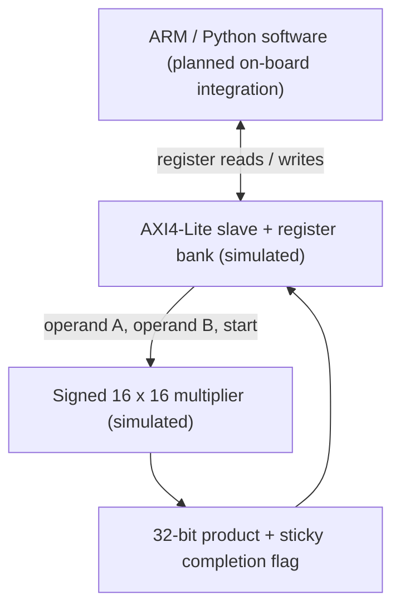

# FPGA Compute Accelerators

**Hardware/software co-design learning project — from signed arithmetic to FPGA-based numerical kernels for control and neural-network workloads.**

> **Current verified deliverable:** `signed_mult_axi` v1.0, a **16-bit signed multiplier** with a **32-bit AXI4-Lite register interface**, verified in Vivado XSim and packaged as reusable Vivado IP.
>
> **Important:** the custom IP has **not yet been synthesized, implemented, or tested on the RFSoC board**. The planned board integration is separate work.

## Why this project exists

Model Predictive Control (MPC) and recurrent neural network (RNN) solvers require repeated numerical computation. This project develops the hardware building blocks and processor-to-FPGA control interfaces necessary to study such computation, beginning with the smallest useful operation: a signed multiplication.

The long-term research direction is to compare digital MPC implementations with an RNN-based solver on an FPGA, evaluating functional accuracy, latency, resource use, and throughput **after hardware implementation**. This repository documents concrete steps toward that goal; it is not a completed MPC solver.

## Milestone 1: AXI4-Lite signed multiplier



| Component | State | Evidence |
| --- | --- | --- |
| Signed 16×16 RTL multiplier | **Verified in simulation** | 7/7 arithmetic tests passed |
| AXI4-Lite operand/control/status/result interface | **Verified in simulation** | 7 arithmetic cases + read-only-register and byte-strobe tests passed |
| Vivado IP packaging | **Completed** | `signed_mult_axi_v1.0` found in IP Catalog |
| Integration into the RFSoC PS/PL design | **Not yet performed** | Requires an RFSoC-capable Vivado installation |
| Python MMIO control of this custom IP | **Not yet performed** | Requires a hardware overlay and known mapped base address |

### Register map

| Offset | Register | Software access | Behavior |
| --- | --- | --- | --- |
| `0x00` | `OPERAND_A` | R/W | Lower 16 bits interpreted as signed input A |
| `0x04` | `OPERAND_B` | R/W | Lower 16 bits interpreted as signed input B |
| `0x08` | `CONTROL` | Write command | Write bit 0 = 1, with low-byte strobe, to issue a 1-cycle START pulse |
| `0x0C` | `STATUS` | Read-only | Bit 0 is sticky DONE; resets on new START/reset |
| `0x10` | `RESULT` | Read-only | 32-bit two's-complement product; meaningful when DONE is set |
| `0x14`–`0x1C` | Reserved | Read zero | Writes ignored |

See [register-level behavior](docs/register-map.md) for reset, timing, and polling semantics.

## Repository layout

```text
fpga-compute-accelerators/
├── ip/
│   └── signed_mult_axi_1_0/     # Canonical Vivado IP package; import final files from Vivado
│       ├── component.xml        # REQUIRED FROM YOUR LOCAL VIVADO PACKAGE (not in starter)
│       ├── hdl/                 # REQUIRED FROM YOUR LOCAL VIVADO PACKAGE (not in starter)
│       └── src/signed_multiplier.sv
├── tests/
│   ├── tb_signed_multiplier.sv
│   └── tb_signed_mult_axi.sv
├── docs/
│   ├── architecture.md
│   ├── register-map.md
│   ├── verification.md
│   ├── reproduce.md
│   ├── progress-and-roadmap.md
│   ├── demo-notes.md
│   └── assets/
├── scripts/check_sources.py
└── .gitignore
```

**Starter completeness:** This downloaded starter includes the previously authored multiplier RTL, both self-checking testbenches, documentation, and evidence images. **Before publishing, copy your *actual repackaged* `signed_mult_axi_1_0` folder from the Vivado workstation into `ip/`, replacing/merging the starter folder.** This is essential: the final verified AXI `hdl/*.v` files and `component.xml` are not available to this starter generator, and should not be invented. See [reproduce.md](docs/reproduce.md).

## Reproduce the verification

* Vivado version used: **Vivado ML Standard 2023.1**, XSim, behavioral simulation.
* For the standalone multiplier, compile `ip/signed_mult_axi_1_0/src/signed_multiplier.sv` and `tests/tb_signed_multiplier.sv`; set testbench top to `tb_signed_multiplier`; **Run All**.
* For the integrated AXI peripheral, first copy the actual packaged IP, then compile its three RTL design files with `tests/tb_signed_mult_axi.sv`; set top to `tb_signed_mult_axi`; **Run All**.
* Exact procedure, supported test coverage, and caveats: [Reproduction instructions](docs/reproduce.md) · [Verification evidence](docs/verification.md).

### Measured evidence

The reported XSim tests passed for signed positive/negative/zero/boundary cases, AXI register protection, and an AXI byte-write-strobe case. See [verification.md](docs/verification.md) and the [datapath timing screenshot](docs/assets/axi-waveform.png). These are **functional simulation results**, not measured FPGA operating frequency or throughput.

## Roadmap

1. **Complete:** Signed multiplier RTL, AXI4-Lite integration, simulation, reusable IP packaging.
2. **Next:** Fixed-point MAC unit, accumulation timing, overflow handling, verification.
3. **Planned:** Vector/matrix compute kernels; compare numerical accuracy against software references.
4. **Pending tools:** Integrate a custom IP into an RFSoC board design and demonstrate PYNQ/Python MMIO control.
5. **Research phase:** Use validated kernels in baseline digital MPC and a discrete-time RNN-based solver for MPC; benchmark on hardware.

[Detailed milestone log](docs/progress-and-roadmap.md) · [Architecture and dataflow](docs/architecture.md) · [Demonstration talking points](docs/demo-notes.md)

## Provenance, scope, and release notes

The AXI4-Lite interface originated from the Vivado custom AXI peripheral wizard and was modified to control the custom RTL multiplier. The testbenches and documentation are project material. For a public release, review redistribution terms for any vendor-generated drivers, templates, board support files, or third-party content included in the copied IP package. No project-wide license has been chosen in this starter; choose one after reviewing those terms.

**Not included / not yet claimed:** hardware resource utilization, synthesis timing, FPGA frequency, live RF data, DAC/ADC loopback, PS-to-custom-IP physical integration, or an operational MPC solver.
