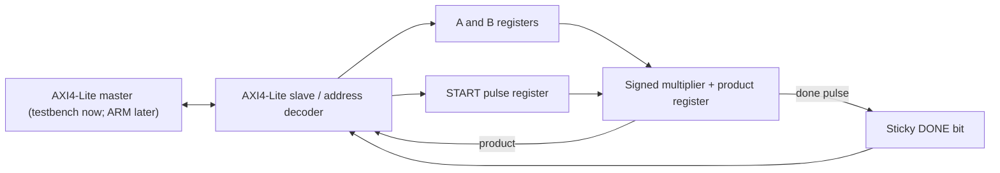

# Architecture and design rationale

## Motivating question

How can software on an embedded processor initiate computation in the FPGA fabric and safely retrieve its result?

## Control versus computation

The `signed_multiplier` module is the **datapath**. It computes a full 32-bit two's-complement product of two signed 16-bit operands and registers it on a rising edge when `start = 1`. When `start = 0`, it retains the previous product. Reset is **synchronous active high** within the core.

The AXI4-Lite wrapper is the **control interface**. It stores input operands, turns a software write to CONTROL into a single-cycle pulse, exposes the product, and retains completion information. Its external AXI reset is **active low** and is inverted before reaching the core.

## Transaction sequence

1. AXI master writes A and B to offsets `0x00`, `0x04`.
2. AXI master writes `1` to CONTROL at `0x08`.
3. Wrapper generates `start` for one cycle and clears previous DONE.
4. Core captures multiplication result and asserts its one-cycle `done` pulse.
5. Wrapper latches the pulse in STATUS.DONE, making completion persist.
6. AXI master reads STATUS until bit 0 is set; then reads RESULT.

The wrapper's sticky bit updates on a subsequent clock edge because sequential blocks using nonblocking assignments observe prior-cycle values at each edge. The attached simulation waveform makes this visible.

## Design limitations to revisit

- This is a **single-cycle registered combinational multiplication datapath**, not a pipelined multiplier with proven timing closure.
- CONTROL is command-oriented rather than a persistent writeable register; software should not rely on reading its transient pulse.
- The generated AXI slave and the testbench use a **simple coupled AW/W flow**. We have not demonstrated independent AW and W arrival timing, all backpressure patterns, formal protocol compliance, or simultaneous accesses.
- STATUS/RESULT writes are ignored but the current wizard response still reports AXI OKAY; strict access-error responses are future work.
- `RESULT` can contain an old product before DONE becomes 1. Always check STATUS first.
- Exactly one command at a time is assumed by this version.
- No RFSoC-specific overlay exists yet for this custom IP.

## Why it matters for MPC

Multiplication is a primitive for a multiply-accumulate (MAC), a dot product, a matrix–vector product, and several recurrent neural computation kernels. The next phase will add controlled accumulation, explicit numeric formats, and verification against a software reference.
