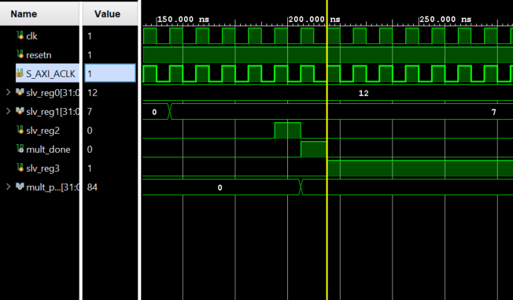
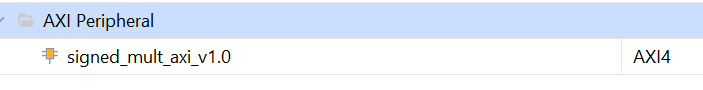

# Verification results and evidence

**Environment:** Vivado ML Standard 2023.1, Vivado XSim, behavioral simulation. The results below were reported from actual simulation runs.

## Stage 1 — standalone signed multiplier

| A | B | Expected product | Status |
| ---: | ---: | ---: | --- |
| 12 | 7 | 84 | PASS |
| -12 | 7 | -84 | PASS |
| 0 | -271 | 0 | PASS |
| 300 | -400 | -120000 | PASS |
| 32767 | 32767 | 1073676289 | PASS |
| -32768 | -32768 | 1073741824 | PASS |
| -32768 | 32767 | -1073709056 | PASS |

**Reported:** `ALL PASS: 7 signed multiplication cases`.

## Stage 2 — AXI-controlled multiplier

The self-checking AXI testbench reported **all seven arithmetic tests passed through register read/write transactions**, plus:

```text
PASS: STATUS and RESULT ignore software writes
PASS: AXI byte write strobes
ALL PASS: AXI-controlled signed multiplier tests
```

The AXI testbench drives the vendor-template AXI write address/data channels together. This does not constitute exhaustive AXI4-Lite protocol coverage. The read-only-register test checks that writes are ignored, **not** that an AXI access-error response is issued.

## Waveform evidence



The core `done` is a short pulse; STATUS stays asserted afterwards, preserving completion for a software poll. The result remains 84 after the pulse.

## Vivado IP Catalog evidence



Packaging confirmation: the IP was repackaged and then discovered by Vivado as `signed_mult_axi_v1.0` under the user AXI Peripheral repository.

## What has **not** been tested

- No device-level synthesis/implementation/timing closure or resource utilization measured.
- No RFSoC PS/PL hardware deployment or live Python MMIO result.
- No performance comparison with a software multiply.
- No exhaustive AXI handshake/backpressure, concurrent requests, or formal protocol verification.

These belong to future milestones and should not be inferred from passing behavioral simulation.
